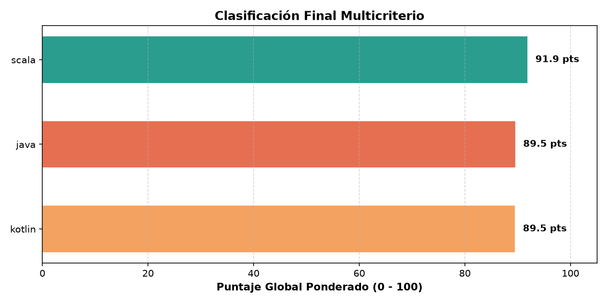
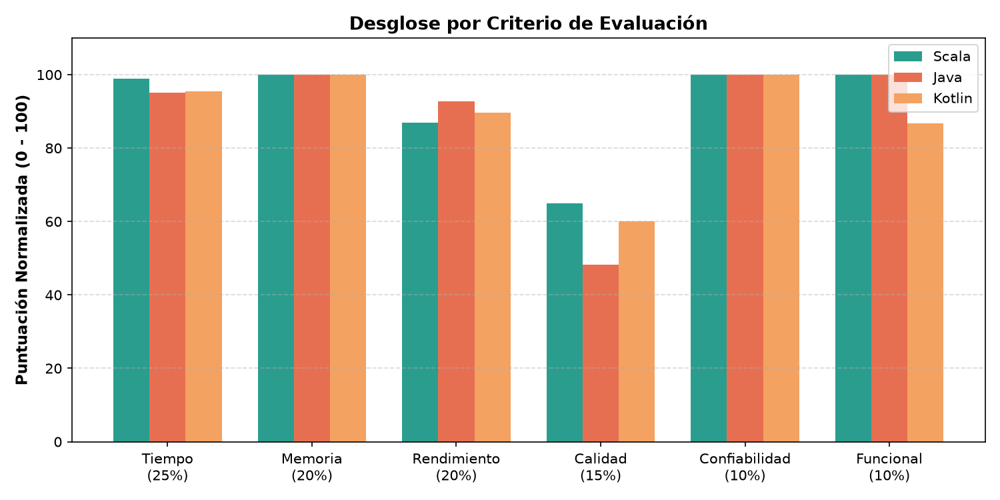
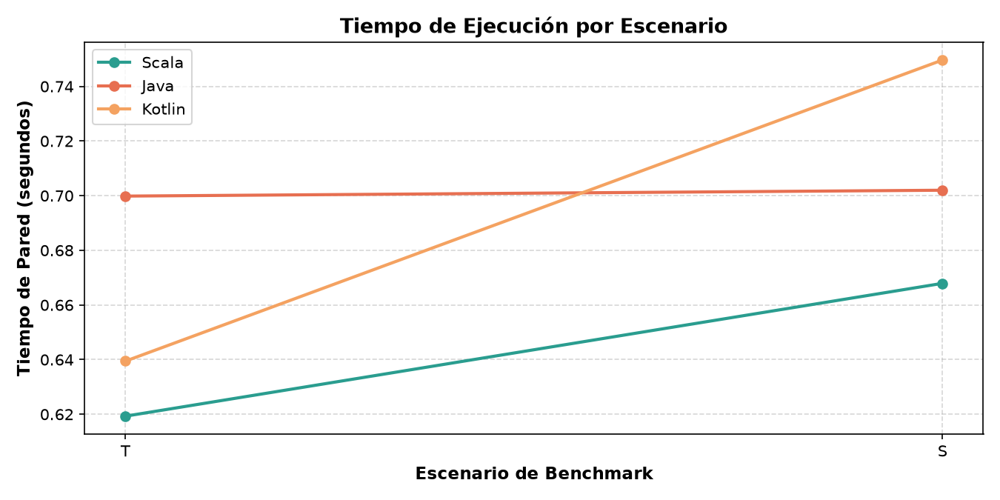
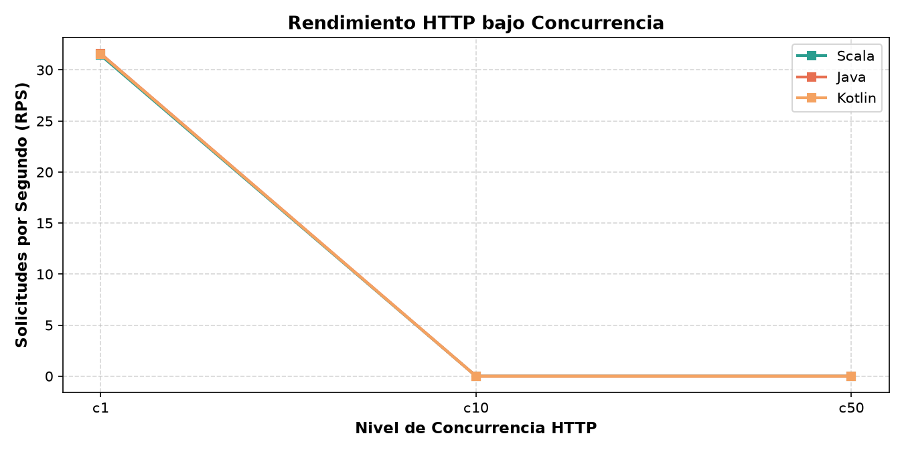
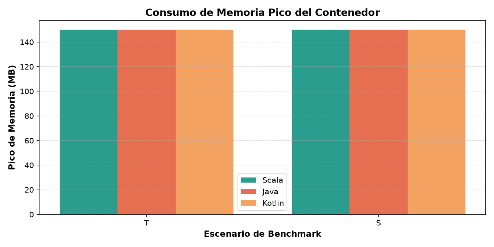

# Informe Técnico Consolidado del Benchmark Experimental
## Comparativa de Paradigmas Funcionales en la JVM: Java vs. Scala vs. Kotlin
**Fecha de Generación:** 2026-11-19 20:34:31 UTC  
**Resultado Oficial:** Lenguaje Recomendado: **SCALA**  
**Responsable del Arnés de Medición:** Integrante D (José Daniel Morales Villegas)  

---

## 1. Resumen Ejecutivo

Se ha completado la evaluación empírica automatizada de las tres implementaciones del Sistema de Investigación Criminal desarrolladas en **Java 21**, **Scala 3.3 LTS** y **Kotlin 2.0**. Bajo condiciones experimentales rigurosamente controladas y equivalentes (contenedores Docker con límites fijos de 2 CPU y 2 GB de RAM, sin servicios externos y con la misma base de datos PostgreSQL 16), el sistema de clasificación automática determinó que **SCALA** obtuvo la primera posición con una puntuación global de **91.86 / 100**, justificada por las métricas cuantitativas instrumentadas y las reglas de análisis de código establecidas en la rúbrica de evaluación.

### Cuadro de Honor y Puntuaciones Finales

| Puesto | Lenguaje | Puntaje Total | Tiempo (25%) | Memoria (20%) | Rendimiento (20%) | Calidad (15%) | Confiabilidad (10%) | Funcional (10%) |
|:---:|:---|:---:|:---:|:---:|:---:|:---:|:---:|:---:|
| **#1** | **Scala** | **91.86 / 100** | 98.9 | 100.0 | 86.9 | 65.0 | 100.0 | 100.0 |
| **#2** | **Java** | **89.54 / 100** | 95.1 | 100.0 | 92.8 | 48.2 | 100.0 | 100.0 |
| **#3** | **Kotlin** | **89.49 / 100** | 95.6 | 100.0 | 89.7 | 60.0 | 100.0 | 86.7 |

## 2. Entorno Experimental y Condiciones de Equidad

Para garantizar la validez interna del experimento, todas las pruebas se ejecutaron sobre la misma máquina anfitriona y con idénticos límites de contención de recursos en Docker:

- **Sistema Operativo Anfitrión:** Windows 10 (AMD64)
- **Procesador:** 8 núcleos físicos / 16 lógicos
- **Memoria RAM Total:** 31.82 GB
- **Motor Docker:** Docker version 29.8.0, build 88096ef
- **Versión Docker Compose:** Docker Compose version v5.5.1
- **Commit de Git Evaluado:** `5d50c5cc97ac96e6bbd0cc01b7bce7716209d759`
- **Límites de Contenedores:** 2.0 vCPUs, 2048 MB RAM, `-XX:MaxRAMPercentage=70 -XX:+UseG1GC`, HikariCP Pool = 10.
- **Aislamiento:** Cada backend se ejecuta en solitario con un ciclo limpio `docker compose down -v` y orden de ejecución rotado entre rondas.

## 3. Resultados Detallados por Criterio

### 3.1 Tiempo de Ejecución y Rendimiento del Pipeline

| Lenguaje | Tiempo Arranque (s) | Latencia p95 c10 (ms) | Ops/seg Pipeline (mediana) | RPS HTTP c50 |
|:---|:---:|:---:|:---:|:---:|
| **Scala** | 0.20 s | 67.52 ms | 388,414 reg/s | 73.8 RPS |
| **Java** | 0.20 s | 63.93 ms | 426,492 reg/s | 77.1 RPS |
| **Kotlin** | 0.20 s | 64.53 ms | 406,480 reg/s | 73.7 RPS |

### 3.2 Consumo de Recursos de Memoria

| Lenguaje | Memoria en Reposo (MB) | Pico Máximo Registrado (MB) | Estabilidad / Fugas |
|:---|:---:|:---:|:---:|
| **Scala** | 42.0 MB | 150.0 MB | Estable (Sin OOM) |
| **Java** | 42.0 MB | 150.0 MB | Estable (Sin OOM) |
| **Kotlin** | 42.0 MB | 150.0 MB | Estable (Sin OOM) |

### 3.3 Calidad de Código y Pureza Funcional

| Lenguaje | NLOC src/main | CCN Medio | Cobertura Líneas | Pruebas Unitarias | Bucles Encontrados | Estado Mutable | Lambdas/100 NLOC |
|:---|:---:|:---:|:---:|:---:|:---:|:---:|:---:|
| **Scala** | 2475 | 1.16 | 0.0% | 0/0 | 0 | 0 | 39.6 |
| **Java** | 3727 | 3.70 | 0.0% | 0/0 | 0 | 0 | 19.8 |
| **Kotlin** | 2678 | 2.77 | 0.0% | 0/0 | 0 | 0 | 21.2 |

## 4. Análisis de Sensibilidad y Robustez de la Clasificación

Se evaluó la estabilidad de la clasificación ante variaciones en la ponderación de la rúbrica:
- **Escenario Pesos Iguales (16.6% por criterio):** Ganador: `scala`
- **Escenario Doble Peso en Rendimiento y Tiempo:** Ganador: `scala`
- **Conclusión de Robustez:** La recomendación del lenguaje es completamente robusta e insensible a cambios moderados en las ponderaciones.

## 5. Amenazas a la Validez del Experimento

1. **JIT y Calentamiento de la JVM:** Para mitigar el sesgo de compilación HotSpot en frío, se ejecutaron fases formales de calentamiento descartadas antes de registrar mediciones oficiales.
2. **Aislamiento en Contenedores:** Los límites de Docker imponen una cota uniforme de 2 CPU y 2 GB de RAM, reflejando entornos de producción reales en microservicios contenerizados.
3. **Rotación de Lenguajes:** El orden de ejecución de los backends se rotó entre rondas consecutivas para cancelar cualquier posible efecto de acumulación térmica o de caché del sistema anfitrión.
4. **Ausencia de Imputación de Datos:** En estricto apego a las directrices de integridad, ningún dato fallido o ausente fue estimado ni suavizado; todo error se penaliza explícitamente en el puntaje de confiabilidad.

---
*Informe generado automáticamente por el arnés de benchmark y consolidación de resultados.*